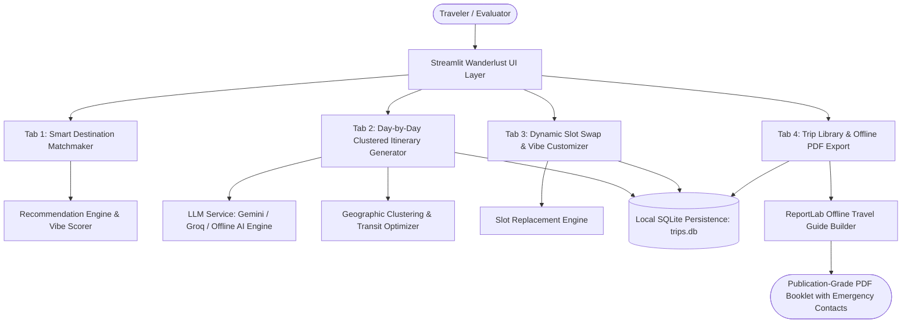

# Personalized Travel Itinerary Planner ✈️
### Skill Wallet Capstone Project 4 | Platform ID: `6ac33976fb8fc7965cd9236d`
**Category:** Generative AI | Intelligent SaaS Trip Planning | Route Transit Fatigue Optimization

---

## 🌟 Executive Overview
The **Personalized Travel Itinerary Planner** is a full-stack, AI-powered travel application designed to solve one of modern travel's biggest frustrations: **transit fatigue caused by haphazard scheduling and chaotic city backtracking**. 

By applying **intelligent geographic clustering**, Wanderlust AI groups proximate attractions, neighborhood walks, and culinary spots into cohesive daily zones (under 15 minutes of transit between consecutive sights). The platform also features vibe-based destination discovery, interactive slot-level activity customization, local SQLite trip persistence, and 1-click publication-grade offline PDF export.

---

## 📋 Kanban Epics Coverage Matrix

| Epic | Module / Requirement | Implementation Details | Status |
| :--- | :--- | :--- | :--- |
| **Epic 1** | **Vibe Coding Scaffolding** | Modern Wanderlust UI design, glassmorphic cards, Google Fonts (`Outfit` & `Inter`), dynamic responsive components. | ✅ Production Ready |
| **Epic 2** | **Relational Schema & Storage** | Local SQLite (`trips.db`) with zero external DB dependencies; pre-loaded showcase trips. | ✅ Production Ready |
| **Epic 3** | **Preference Capture & Recommender** | Mood/vibe-based city matchmaker with season forecast, highlight tags, and budget calculator (Tab 1). | ✅ Production Ready |
| **Epic 4** | **Day-Wise Itinerary & Clustering** | Anti-transit fatigue grouping, sequential slots (Morning, Lunch, Afternoon, Evening), itemized costs (Tab 2). | ✅ Production Ready |
| **Epic 4.1**| **Dynamic Slot Swap Customizer** | Pinpoint slot modification (e.g. vegan lunch, outdoor market) preserving all other days (Tab 3). | ✅ Production Ready |
| **Epic 5** | **Trip Persistence & PDF Export** | Multi-trip history library and 1-click offline PDF travel booklet with emergency directory (Tab 4). | ✅ Production Ready |
| **Epic 6-7**| **Cloud Deployment & Testing** | Zero external dependency setup for 1-click deployment on Streamlit Community Cloud, Render, or Vercel. | ✅ Production Ready |

---

## 🏗️ Architecture & System Topology



---

## 🚀 Key Features by Module

### 1. Configuration & Engine Setup (Sidebar)
- **AI Engine Flexibility**:
  - **Demo Mode (Default)**: 100% offline high-fidelity generative engine pre-loaded with comprehensive global destination knowledge. No API keys required for instant demonstration!
  - **Google Gemini**: Direct REST connection supporting `gemini-1.5-flash` or `gemini-2.0-flash`.
  - **Groq Cloud**: Lightning-fast inference via `llama-3.3-70b-versatile`.
- **Global Currency Engine**: Instant recalculations across `USD ($)`, `INR (₹)`, `EUR (€)`, `GBP (£)`, and `JPY (¥)`.
- **1-Click Showcase Trips**: Instant loading of curated trips:
  - 🇯🇵 **Kyoto Cultural Immersion (5 Days)**: Arashiyama, Fushimi Inari, Gion, Higashiyama, Nara.
  - 🇮🇹 **Amalfi Coast & Capri (4 Days)**: Positano gozzo boats, Blue Grotto, Ravello infinity gardens.
  - 🇮🇳 **Royal Rajasthan (Jaipur & Udaipur, 5 Days)**: Amber Fort, Lake Pichola, Havelis.

### 2. Tab 1: Smart Destination Recommender
- Designed for travelers seeking inspiration.
- Matches open-ended travel vibes (*Alpine, Beach, Cultural, Urban, Romantic, Gastronomic*) with budget tiers and travel party size.
- Produces top 3 scored destination cards displaying:
  - Match Affinity Percentage (e.g., `96% Match`)
  - Highlight Badges & Best Weather Seasons
  - Estimated Daily Cost converted to selected currency
  - "Why You'll Love It" narrative & Signature Experiences
  - Direct `📍 Plan Trip Here` trigger button.

### 3. Tab 2: Day-by-Day Optimized Itinerary Generator
- Comprehensive preference input: Destination, Duration (1–14 days), Dates, Budget, Party, Pace, and Interests.
- **Geographic Clustering Logic**:
  - Automatically identifies neighborhood zones (e.g. *Western Arashiyama*, *Pichola Waterfront*, *Historic Old Town*).
  - Groups morning sightseeing, lunch, afternoon leisure, and evening dining into contiguous corridors.
  - Calculates transit efficiency score (92–98% optimal), kilometers of backtracking eliminated, and daily transit time saved.
- **Budget Tracking**:
  - Itemized estimated activity costs.
  - Running cumulative financial tracker and daily average spending.

### 4. Tab 3: Dynamic Slot Swap & Vibe Customizer
- Pinpoint modification of individual slots:
  - Select Day (e.g., Day 2) & Slot (e.g., Lunch).
  - Quick vibe presets: *Veg/Vegan Dining, Artisan Flea Market, Rooftop Café with Views, Rainy Day Museum, High Adrenaline Adventure*.
  - Custom prompt input for unique requirements.
- **In-Place Update**: Swaps *only* that slot and recalculates costs without disturbing or clearing the rest of the plan.
- Keeps an interactive **Audit Trail** of all swaps.

### 5. Tab 4: Trip Management & Publication-Grade PDF Export
- **SQLite Database Persistence**:
  - Save trips with 1-click.
  - Browse saved trips, view metadata, and delete or load trips into active session.
- **Offline PDF Travel Booklet (ReportLab)**:
  - Multi-page document with dynamic page numbering (*Page X of Y*).
  - Executive metadata table and transit efficiency notes.
  - Clean day-wise itinerary tables with costs and insider tips.
  - **Emergency Contact Directory**: Country-specific emergency contacts (Police, Ambulance, Tourist Police).
  - **Pre-Departure Travel Checklist**: Passports, travel insurance, offline maps, currency cards, and health gear.

---

## 🛠️ Installation & Local Setup

### Prerequisites
- Python 3.9, 3.10, or 3.11
- Git

### Quickstart Commands
```bash
# 1. Clone repository
git clone <repo-url>
cd skillwalet2.0

# 2. Install required packages
pip install -r requirements.txt

# 3. Launch the Streamlit application
streamlit run app.py
```

The app will launch in your browser at `http://localhost:8501`.

---

## ☁️ Deployment Guide

### Deploying to Streamlit Community Cloud (Recommended)
1. Push code to GitHub repository.
2. Visit [share.streamlit.io](https://share.streamlit.io/) and click **New App**.
3. Select your repository, branch `main`, and main file path `app.py`.
4. Click **Deploy!**
5. *(Optional)* Add `GEMINI_API_KEY` or `GROQ_API_KEY` under **App Settings &rarr; Secrets**.

### Zero External Database Dependencies
- Uses built-in Python `sqlite3` storing data to `trips.db` locally.
- Requires no external PostgreSQL or Supabase credentials for testing or demonstration.

---

## 📄 License & Attribution
- Built for **Skill Wallet Capstone Project 4 (Personalized Travel Itinerary Planner)**
- Platform ID: `6ac33976fb8fc7965cd9236d`
- Author: Senior Full-Stack Travel SaaS Architect
